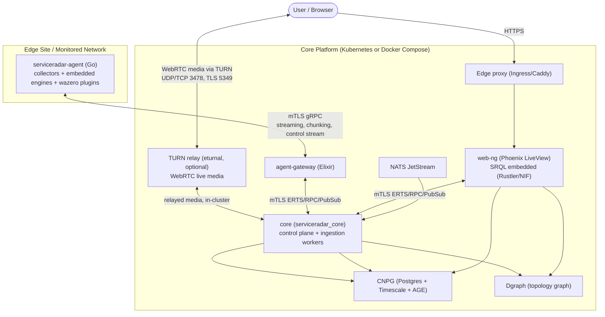
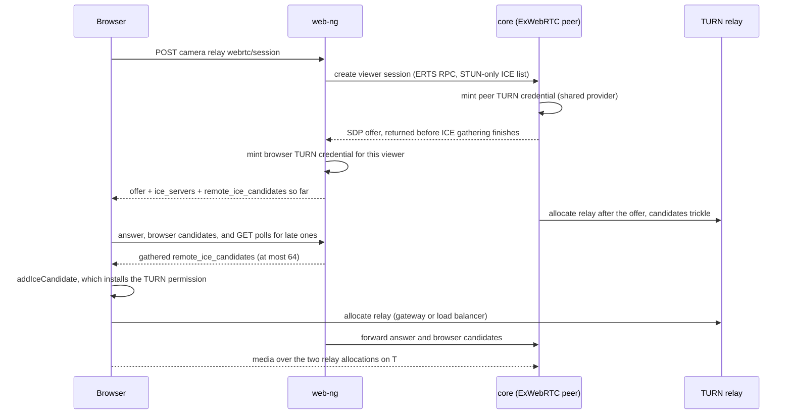

For SPIRE compatibility and upgrade guidance, see [Migrating off SPIRE](./migrating-off-spire.md).

# Architecture

ServiceRadar is an IT operations and network management platform — covering network
monitoring, observability, and security analytics — built on an Elixir/ERTS control plane
and a single Go edge agent. The agent runs collectors and sandboxed Wasm plugins, then
streams results to the platform over mTLS gRPC.

This page stays high-level on purpose. It aims to give you the correct mental model before you dive into specific protocol or deployment docs.

## High-Level System Diagram

Topology is the one dataset with two stores during the Dgraph rollout: mapper
evidence stays in CNPG, Dgraph is the traversal graph, and Apache AGE keeps
receiving the same writes until the cutover. See
[Network Topology](./network-topology.md).

## Control Plane (ERTS Cluster)

The core platform is an ERTS cluster of:

- `core`: APIs, orchestration, ingestion, and persistence. The control-plane OTP
  application is `serviceradar_core`; the `core` service runs it via the
  `serviceradar_core_elx` wrapper, which enables cluster mode and schedulers but
  starts no duplicate children of its own.
- `web-ng`: UI and HTTP API surface; SRQL is embedded via Rustler/NIF
- `agent-gateway`: edge ingress (agent connectivity and ingestion)

These components communicate internally over mTLS-secured Erlang distribution (ERTS), using RPC and PubSub semantics.

## Edge Agent

`serviceradar-agent` is the single edge runtime. It connects outbound to `agent-gateway` and:

- runs built-in collectors and engines (for example sync integrations, SNMP polling, discovery/mapping, mDNS)
- executes sandboxed Wasm plugins using `wazero`
- streams results using unary and streaming gRPC (chunked payloads for large datasets)
- participates in a bidirectional control stream for control-plane signaling

See [Edge Model](./edge-model.md).

## Live Media (WebRTC) And The TURN Relay

Camera live view can play over WebRTC. The sending peer is an ExWebRTC peer in
`core` (the `serviceradar_core_elx` release); `web-ng` only relays signaling.
A browser outside the cluster cannot reach that peer directly, so the chart can
deploy an optional TURN relay (eturnal). Both sides allocate a relay address on
it and media flows from the browser through TURN to core:

Credentials are short-lived TURN REST HMAC credentials minted per viewer by the
shared ICE credential provider from a shared secret that only web-ng, core and
the TURN server mount. If no relay is configured or minting fails, the viewer
falls back to the websocket transports. See
[WebRTC TURN Relay](./webrtc-turn-relay.md).

## Notification Availability And The Failure Domain

Notification availability is bounded by `core` availability, deliberately and by
construction.

The alert engine runs in `core`. A `core` outage therefore means there are no
alerts to notify about, so there is nothing an independently available delivery
path could deliver. Building notification delivery to survive a `core` outage
would be a high-availability story with no engine behind it.

This matters because of a distinction that is easy to lose. A notification
channel can be routed through a `serviceradar-agent` inside a customer network
(`execution_route: edge_agent`), and that looks like an availability feature. It
is not one. Agent routing exists for **egress locality** - so a notification
leaves from inside the customer's own network, reaching a destination the control
plane cannot see - and an agent-routed channel still depends on `core` to decide
that a notification should be sent at all.

A genuine high-availability answer requires an edge-resident rule engine, which
ServiceRadar does not have and which would be a different design. Until then,
plan `core` availability as the availability of alerting itself.

## Bulk Telemetry Pipeline (NATS JetStream)

Collectors publish bulk telemetry into JetStream (commonly the `events` and
`metrics` streams). The platform runs:

- in-process Zen normalization and persistence workers inside `serviceradar_core`
- EventWriter, whose logs consumer also promotes logs that match an event rule
  into OCSF events as it stores them

See [Data Pipeline](./data-pipeline.md).

### Kubernetes HA Profile

The Helm chart defaults stay conservative, but a validated Kubernetes HA profile
runs the control plane and ingest workers with multiple replicas. For the
queue-backed services, the HA pattern is shared JetStream streams and shared
durable pull consumers rather than local singleton disk state. See
[Helm Configuration](./helm-configuration.md) for replica counts and JetStream
sizing.

## Identity And TLS

- Everything is mTLS by default.
- Deployment-managed mTLS is the supported identity model. For legacy installations, see [Migrating off SPIRE](./migrating-off-spire.md).
- Docker Compose uses mTLS bootstrapping (cert generation + distribution via volumes).

See [TLS / mTLS](./tls-security.md).
