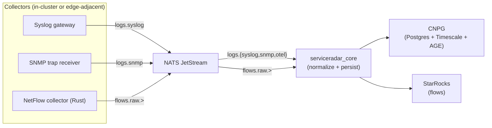

# Data Pipeline

ServiceRadar uses two primary data paths:

- Agent ingestion (edge status, discovery, sync) via mTLS gRPC to `agent-gateway`
- Bulk telemetry ingestion via NATS JetStream. EventWriter persists logs and the other CNPG telemetry datasets. NetFlow is stored only in StarRocks; see [NetFlow](./netflow.md#flow-cutover-and-delivery).

This page is intentionally high-level. It focuses on the mental model and the moving parts you will see when debugging.

## NATS JetStream (Bulk Ingestion)

Bulk collectors publish to NATS JetStream. The most common stream is `events`.

`serviceradar_core` is the bulk-ingestion writer for these streams. It runs the
Zen decision rules in-process for log normalization and persists log records
into CNPG. Flow batches are Stream Loaded to StarRocks and are not written to
CNPG; see [NetFlow](./netflow.md#flow-cutover-and-delivery). EventWriter's logs
consumer promotes logs that match an event rule into
OCSF events as it stores them; there is no separate promotion consumer, so each
log is promoted once, under an id derived from the JetStream message.

When a metric batch still arrives on the status path, `agent-gateway` splits
oversized protobuf batches before publishing them to NATS. The gateway uses the broker-advertised
`max_payload` with headroom for NATS headers; no agent-side batch-size setting
is required. Large multi-port sweep groups can therefore produce several
messages on the same subject. A warning reports the original byte count,
broker limit, number of parts and `dropped_points`. A point that cannot fit by
itself is dropped; if no parts remain, publishing returns an error. The
payload-budget and per-part deduplication contracts live in
`ServiceRadarAgentGateway.MetricBatchPublisher` and
`ServiceRadarAgentGateway.MetricBatchSplit`.

When the agent's metrics spool is enabled and it holds a current
`serviceradar.metrics.batch` grant, its sysmon, SNMP, ICMP and MTR scalar metrics
and its periodic sweep summary leave the status path on that one grant. Each
producer keeps its own queue. Full MTR traces from agent-scheduled checks leave
the status path on their own queue when the agent holds a current
`serviceradar.mtr.scheduled_trace` version 1 grant, and are projected by
`ServiceRadar.Edge.Projectors.ScheduledMtrTrace`; without that grant they stay
on the status path. Results of a
sweep group the agent runs from its own config, and the metric batch on each of
those results chunks, leave the status path together only while the agent also
holds a current `serviceradar.sweep.unleased_results` version 1 grant. Without
that grant, and for a leased sweep group, the response stays on the status path.
The agent splits each metrics record at 512 KiB. An unleased sweep results
record is split by halving the host list so it stays within that grant's row
ceiling and 512 KiB, and core ingests it on the results path the status
message used. Core republishes the metric records onto the same
`metrics.sysmon.>`, `metrics.snmp.>`,
`metrics.icmp.>`, `metrics.mtr.>` and `metrics.sweep.>` subjects. Core also
admits `rperf-metrics` batches onto `metrics.rperf.>`; the agent has no rperf
producer of its own.

That same spool carries flow-attribution windows and OTLP relay frames, and
only while the metrics spool is connected (`edgeRecords.agentMetricsEnabled`
on the chart). A current `serviceradar.netprobe.flow_attribution` version 1
grant then takes drained windows off the `source=flow-attribution` status
path. A current `serviceradar.otlp.relay` version 1 grant appends fitting OTLP
records to that spool. A record that does not fit the 512 KiB edge-record cap
still goes out as `source=otlp-relay`. The add-on is acked only after every
fitting record is in the spool and every oversized record has been accepted
on that status path. Without the spool or the matching grant, each producer
stays on its status path. Core republishes a
fresh flow-attribution record through the same observation publish the status
path uses, and republishes an OTLP relay record onto `otel.traces.raw`,
`logs.otel`, `otel.metrics.raw`, and `otel.metrics.derived`. Payload rules are
the comments on `FlowAttributionEventBatch` and `OtlpRelayFrame`.

The Helm chart README documents that opt-in
(`edgeRecords.agentMetricsEnabled`). The publish rules are
`ServiceRadar.Edge.MetricsBatchProjection`.

Plugin and native add-on telemetry follows the same shape under the
`serviceradar.telemetry.batch` contract (`edgeRecords.agentTelemetryEnabled`).
With that spool enabled and a current grant, the batch leaves the status path;
without the grant, the status path still carries it. The agent host stamps
the producing assignment or add-on into each batch; plugins and add-ons never
hold a contract of their own. Core attests and republishes
`serviceradar_metrics` records onto `metrics.timeseries.>`, and routes OCSF
event, OTel log and discovery records through the same status ingestor
destinations as the legacy path. A discovery record on this contract is
admitted only from a native add-on. The routing rules are
`ServiceRadar.Edge.Projectors.TelemetryBatch`.

## Data Service (datasvc)

`datasvc` is a gRPC service (port `50057`) that fronts the platform's NATS-backed
key-value and object stores. Other components use it for shared configuration and
state—for example, the KV bucket `serviceradar-datasvc` holds rule definitions
and runtime settings, and the object store carries larger payloads. Routing this
state through one service keeps NATS KV/object access consistent and avoids
components manipulating JetStream buckets directly.

## CNPG (System Of Record)

CNPG is the system of record for inventory, telemetry, and analytics (Timescale hypertables and AGE graph features are enabled in the cluster).

An optional StarRocks warehouse (off by default) can hold migrated telemetry
history -- flows, scalar metrics, logs, event history, and further append-only
datasets, including BMP routing events -- written by the same EventWriter path.
The BMP table and retention contract is in `k8s/starrocks/README.md`. CNPG
remains the system of record for inventory,
configuration, credentials and current alert state, and keeps serving scalar
metrics, logs and event history until each is explicitly cut over. Flows are
stored only in StarRocks and are never written to CNPG. Without the warehouse
they are not stored, and `in:flows` and the NetFlow dashboard are refused. See
[NetFlow](./netflow.md#flow-cutover-and-delivery) and
[Helm Deployment and Configuration](./helm-configuration.md) for the chart
values and where the warehouse install is documented.

Querying happens through the web UI and SRQL, which is embedded in `web-ng`.
