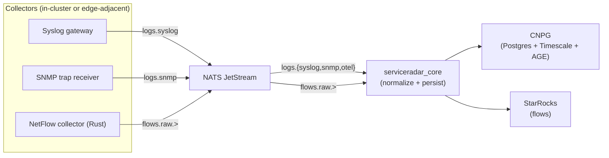

# Data Pipeline

ServiceRadar uses two primary data paths:

- Agent ingestion (durable edge records and ephemeral status summaries) via mTLS gRPC to `agent-gateway`
- Bulk telemetry ingestion via NATS JetStream. EventWriter persists logs and the other CNPG telemetry datasets. NetFlow is stored only in StarRocks; see [NetFlow](./netflow.md#flow-cutover-and-delivery).

This page is intentionally high-level. It focuses on the mental model and the moving parts you will see when debugging.

## NATS JetStream (Bulk Ingestion)

Bulk collectors publish to NATS JetStream. The most common stream is `events`.



`serviceradar_core` is the bulk-ingestion writer for these streams. It runs the
Zen decision rules in-process for log normalization and persists log records
into CNPG. Flow batches are Stream Loaded to StarRocks and are not written to
CNPG; see [NetFlow](./netflow.md#flow-cutover-and-delivery). EventWriter's logs
consumer promotes logs that match an event rule into
OCSF events as it stores them; there is no separate promotion consumer, so each
log is promoted once, under an id derived from the JetStream message.

Every durable agent data family travels only as edge records: the agent spools
each record to disk, `agent-gateway` verifies it and stores it in JetStream (or
rejects it permanently, and the agent quarantines it locally), and EventWriter
projects each primary-stream record once. The agent status RPCs (`PushStatus`,
`StreamStatus`) carry only ephemeral status summaries, the agent capability
status and plugin-engine counters, and the gateway refuses and counts any
durable data an older agent still sends there. A producer emits records only
under the standing grant core issues for its contract, and holds its data
rather than falling back when it has none. The guarantee, grants, hold rules,
dead-lettering, readiness conditions and troubleshooting are described in
[Durable Edge Records](./durable-edge-records.md). The rest of this section is
how each family is projected.

Sysmon, SNMP, ICMP, rperf and MTR scalar metrics and the periodic sweep summary
share the `serviceradar.metrics.batch` grant. Each producer keeps its own queue
or pending-item state. Full MTR traces, from agent-scheduled checks and from a
sweep group's `mtr` mode, use the `serviceradar.mtr.scheduled_trace` version 1
grant and are projected by `ServiceRadar.Edge.Projectors.ScheduledMtrTrace`
(see [Network Sweeps](./network-sweeps.md)). Results of a sweep group the agent
runs from its own config, and the metric batch on each of those results
chunks, are spooled together under the `serviceradar.sweep.unleased_results`
version 1 and metrics grants. A leased sweep group emits observation batches
from its lease instead. A results response that cannot form the typed batch,
or whose first record the spool refuses permanently, is dropped and counted.
The agent splits a metrics batch into records of at most 512 KiB; a single
metric point that no record can hold is dropped and counted. An unleased sweep results
record is split by halving the host list so it stays within that grant's row
ceiling and 512 KiB. Core republishes the metric records onto the
`metrics.sysmon.>`, `metrics.snmp.>`, `metrics.icmp.>`, `metrics.rperf.>`,
`metrics.mtr.>` and `metrics.sweep.>` subjects. The publish rules are
`ServiceRadar.Edge.MetricsBatchProjection`.

That same spool carries flow-attribution windows and OTLP relay frames, under
the `serviceradar.netprobe.flow_attribution` version 1 and
`serviceradar.otlp.relay` version 1 grants. An OTLP relay record larger than
the 512 KiB edge-record cap is skipped, counted and acked. The add-on is acked
only after every other record of its frames is in the spool. Core republishes
a flow-attribution record through the observation publish, and an OTLP relay
record onto `otel.traces.raw`, `logs.otel`, `otel.metrics.raw`, and
`otel.metrics.derived`. Payload rules are the comments on
`FlowAttributionEventBatch` and `OtlpRelayFrame`. The publish rules are
`ServiceRadar.Edge.Projectors.FlowAttribution` and
`ServiceRadar.Edge.Projectors.OtlpRelay`.

Plugin and native add-on telemetry use the `serviceradar.telemetry.batch`
contract. The agent host stamps the producing assignment or add-on into each
batch; plugins and add-ons never hold a contract of their own. Core attests and
republishes `serviceradar_metrics` records onto `metrics.timeseries.>`, and
routes OCSF event, OTel log and discovery records to their existing
destinations. A discovery record on this contract is admitted only from a
native add-on. The routing rules are
`ServiceRadar.Edge.Projectors.TelemetryBatch`.

Wasm plugin results use the `serviceradar.plugin_results.batch` contract.
Drained results are grouped by their host-stamped provenance. Core rebuilds
each result's payload and status and ingests it through
`ServiceRadar.Observability.PluginResultIngestor`, so per-assignment service
identity and the registered platform handlers apply. The projection rules are
`ServiceRadar.Edge.Projectors.WasmPluginResult`.

Mapper discovery (devices, interfaces, topology), netprobe discovery, and
integration sync pages use the `serviceradar.mapper.devices.batch`,
`serviceradar.mapper.interfaces.batch`, `serviceradar.mapper.topology.batch`,
`serviceradar.netprobe.discovery.batch` and `serviceradar.sync.page.batch`
contracts. The agent converts its update payloads into the typed batches of
`proto/edge/v1/json_producer_batches.proto`; core rebuilds those payloads and
hands them to the sync ingestion pipeline (devices, netprobe and sync pages)
or `MapperResultsIngestor` (interfaces and topology), so the DIRE run ledgers,
incomplete-run population guard and conflicting-identity refusal apply. A
sync page the spool refuses fails its run. The projection rules are the
discovery projectors under `ServiceRadar.Edge.Projectors`.

Workload identity snapshots ride the
`serviceradar.workload_identity.snapshot` contract. The agent holds at most one
built snapshot until the spool admits all of its records, and spools the file
again only when its content changes. Core writes the snapshot through
`ServiceRadar.WorkloadIdentity.persist_snapshot/1`
(`ServiceRadar.Edge.Projectors.WorkloadIdentity`).

Kubernetes public endpoint snapshots use the
`serviceradar.k8s.public_endpoints.snapshot` contract. The agent holds at most
one pending snapshot when the spool refuses it and skips polling the k8s
inventory service until that record is admitted. Core writes the snapshot
through `ServiceRadar.EventWriter.Processors.K8sPublicEndpoints`. It refuses a
malformed snapshot, one that does not match the agent's cluster binding, and
one whose network scope has no partition. The projection rules are
`ServiceRadar.Edge.Projectors.K8sPublicEndpoints`.

Endpoint inventory scans use the `serviceradar.endpoint_inventory.scan`
contract. Each changed scan or `not_scanned` report becomes one
`EndpointInventoryScanPayloadV1` record. The agent holds at most one pending
record and pauses polling until the spool admits it. A scan that cannot form a
record within the body bound, or that the spool refuses, is dropped once and
its upload marked failed. Core ingests it through `EndpointInventoryIngestor`.
The projection rules are `ServiceRadar.Edge.Projectors.EndpointInventory`.

Bumblebee scans use the `serviceradar.bumblebee.scan` contract. Each scan the
agent reads from the spool file is sent as one `BumblebeeScanPayloadV1` record
from `proto/edge/v1/bumblebee.proto`. An unchanged scan is re-sent every 15
minutes so core can re-resolve its device. While one scan waits for spool
admission, the agent stops polling the bumblebee spool. Core feeds the scan to
`BumblebeeIngestor`. The projection rules are
`ServiceRadar.Edge.Projectors.BumblebeeScan`.

## Durable Edge-Record Pipeline

The edge-record pipeline described above is always on. It has no switch in
Helm, in the environment or in CNPG, and Docker Compose and hosted installs run
it with no extra configuration. Core derives the contract registry from the
release's contract catalog and signs each registry epoch with its edge issuer
key, both kept in CNPG; derived epochs are numbered from 1,000,000. Agents always
run the sender and spool.

See [Durable Edge Records](./durable-edge-records.md) for how the pipeline
works, how to operate it, and how to troubleshoot it.

### Upgrading from the static registry

Earlier releases ran the pipeline only when the Helm `edgeRecords` values
turned it on, with a hand-written contract registry. The release that made it
always on removed those values. A render that still sets any `edgeRecords`
key fails with:

```text
edgeRecords was removed: the durable edge-record pipeline is always on and
core derives its contract registry. Delete the edgeRecords block from your
values.
```

Installs that never set `edgeRecords` need no change. Installs that did:

1. Optional drain, on the old release. Records spooled under the hand-written
   registry carry an epoch below 1,000,000. After the upgrade the gateway
   rejects each one permanently as `static_registry_epoch`, counts it, and the
   agent quarantines it; it never blocks a lane. To deliver that backlog
   instead, turn sweep leasing off for each participating agent while still on
   the old release. That revokes the agents' grants, so producers return to the
   status path. Wait until every agent's `agent_edge_spool_unresolved_bytes`
   gauge reaches zero.
2. Delete the `edgeRecords` block from your values, including any copy in an
   Argo CD `valuesObject` or a values file layered on top.
3. Upgrade core and every gateway, then the agents.
4. Confirm that the first derived epoch is active, that agents hold their
   grants again, and that the agents' spools drain.

Core imports the issuer seed the chart's secret generator created
(`edge-issuer-seed`) on its first boot, so grants and epochs signed with that
key keep verifying. Rolling back across this release is not supported: the
same release removes the legacy status path, and records spooled under derived
epochs would be withheld by an older gateway.

## Data Service (datasvc)

`datasvc` is a gRPC service (port `50057`) that fronts the platform's NATS-backed
key-value and object stores. Other components use it for shared configuration and
state—for example, the KV bucket `serviceradar-datasvc` holds rule definitions
and runtime settings, and the object store carries larger payloads. Routing this
state through one service keeps NATS KV/object access consistent and avoids
components manipulating JetStream buckets directly.

## CNPG (System Of Record)

CNPG is the system of record for inventory, telemetry, and analytics (Timescale hypertables and AGE graph features are enabled in the cluster).

An optional StarRocks warehouse (off by default) can hold migrated telemetry
history -- flows, scalar metrics, logs, event history, and further append-only
datasets, including BMP routing events -- written by the same EventWriter path.
The BMP table and retention contract is in `k8s/starrocks/README.md`. CNPG
remains the system of record for inventory,
configuration, credentials and current alert state. Each telemetry dataset is
written only to the store it is read from, never to both: with the warehouse
enabled, scalar metrics, MTR, OTel metrics and traces and BMP routing events
are stored there only, and logs and event history are stored there only once
named in `analytics.starrocks.cutoverDatasets` (CNPG only until then). Flows are
stored only in StarRocks and are never written to CNPG. Without the warehouse
they are not stored, and `in:flows` and the NetFlow dashboard are refused. See
[NetFlow](./netflow.md#flow-cutover-and-delivery) and
[Helm Deployment and Configuration](./helm-configuration.md) for the chart
values and where the warehouse install is documented.

Querying happens through the web UI and SRQL, which is embedded in `web-ng`.
