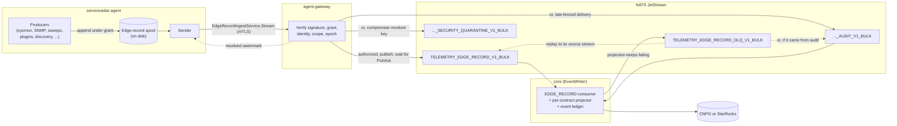

# Durable Edge Records

Every piece of durable data an agent collects reaches the platform as an
**edge record**: a signed, typed record that the agent writes to an on-disk
spool and delivers to `agent-gateway`. The agent lets go of a record only once
the gateway has stored it in NATS JetStream or rejected it permanently, and a
rejected record is moved to a local quarantine first. EventWriter then projects
each record from the primary stream into storage exactly once; an audit-stream
record gets only its ledger row, and a security-quarantine record is held in
JetStream without being written anywhere. This is the only path for agent data. It has no on/off switch in
Helm, in the environment or in CNPG, and it runs the same way on Helm, Docker
Compose and hosted installs and on package-installed agents.

This page explains the guarantee, how a record moves through the system, what
grants a producer needs, how failures are handled, and how to operate and
troubleshoot the pipeline. Per-family routing details (which subjects a record
is republished to, which ingestor stores it) are in
[Data Pipeline](./data-pipeline.md).

## What the pipeline guarantees

- **Nothing is reclaimed before it is resolved.** A record stays in the agent
  spool until the gateway has published it to a replicated JetStream stream and
  received the PubAck, or has rejected it permanently. Only then does the
  gateway acknowledge it, and only then does the agent reclaim its bytes; a
  permanently rejected record is first copied to the agent's local spool
  quarantine.
- **Each record is stored once.** For a primary-stream record, EventWriter
  claims the delivery slot and the event ledger row in the same database
  transaction as the projector's writes; an audit-stream record claims only
  the slot and ledger row, and a security-quarantine record writes nothing. A redelivered or replayed record that the ledger already
  holds writes nothing.
- **Restarts do not lose data.** The agent spool is on disk, the edge-record
  streams are file-backed and replicated, and every hand-off of an accepted
  record between them is acknowledged only after the next stage holds it (the
  exception is the OTel log and OCSF republish described under
  [EventWriter projects the record](#4-eventwriter-projects-the-record)). An agent, gateway, NATS or core
  restart therefore leads to a redelivery, not a gap, as long as EventWriter
  drains the primary stream within its retention (see
  [Messages expired before delivery](#messages-expired-before-delivery)).
- **Loss is counted, never silent.** Where data cannot be carried (a producer
  queue overflowing while it waits for a grant, a record the gateway rejects
  permanently, a projection that keeps failing) it is counted, quarantined or
  dead-lettered, and it shows up in metrics, alerts or the readiness report.
  The one deliberate exception is flow attribution without StarRocks: core
  acknowledges those records and discards them (see
  [EventWriter projects the record](#4-eventwriter-projects-the-record)).

The guarantee starts when a producer's record is admitted to the spool.
Before that, a producer applies the hold rules in
[Without a grant](#without-a-grant).

The retired status path worked differently. Agents sent metrics, results and
inventory inside `StreamStatus`/`PushStatus` messages, drained from memory
before the send succeeded, and the gateway published several of them without
waiting for a PubAck or kept them in a bounded in-memory buffer. A restart or a
slow consumer at the wrong moment lost data without a trace. The status RPCs now
carry only latest-wins summaries (see [What stays on the status
RPCs](#what-stays-on-the-status-rpcs)).

## How a record travels



### 1. Producers append to the spool

Each producer builds a typed record for its output contract and appends it to
the agent's single spool. The spool lives in
`/var/lib/serviceradar/agent/edge-records` on Linux and macOS and in
`C:\ProgramData\ServiceRadar\data\agent\edge-records` on Windows, unless the
agent config sets `edge_record_sender.spool_dir`.

- **Budget.** The spool's byte budget is 1 GiB unless core sends another in the
  agent config (`edge_spool_max_bytes`, from the
  [edge pipeline settings](#settings)). A budget below current usage only
  refuses new appends until the spool drains under it; nothing already spooled
  is dropped.
- **Admission marks.** Producer admission pauses once the spool's ordinary
  bytes reach 80% of the budget's ordinary ceiling and resumes only once
  reclaim brings them down to 50%. The room above the high-water mark is kept
  for records already in flight. A refused append is retryable backpressure:
  the producer keeps the record and tries again.
- **Fairness.** Between the two marks, the remaining room is shared byte-fairly
  between producer flows. A flow is admitted while it has taken less than a
  fixed quantum more than the least-served flow, so one busy producer cannot
  starve the others.

Records are sized to their contract's bounds (512 KiB for metric records).
Metric batches and unleased sweep results too large for one record are split
into several. Input that no single record can hold is not split: a metric
point or an OTLP relay record that large is dropped and counted (the relay
record is still acked to the add-on), and an endpoint-inventory scan that
cannot form a record is dropped once and its upload marked failed.

### 2. The sender delivers to the gateway

The sender opens `EdgeRecordIngestService.Stream` to `agent-gateway` on its own
mTLS connection, one bounded lane session per 30-second poll, asking
for 8 MiB of byte credits and 256 frame credits. It sends the spool's
unresolved records in sequence order.

The gateway authorizes every frame locally, with no core or database lookup per
frame. It checks the exact record digest, the record's structure, the signed
production grant (and any source authorization or delivery grant), that the
record's origin is the authenticated agent, the network scope, route and
traffic class, the validity window, and the registry epoch the record names.
It then admits the record against the exact contract entry of that signed
epoch.

The gateway publishes each authorized record to exactly one of three streams
(the primary stream; the audit stream for a late-fenced delivery; the
security-quarantine stream for a record signed by a compromise-revoked key),
waits for the PubAck, and only then reports the sequence as resolved. Acks carry a
contiguous **resolved watermark**: the first sequence a session cannot resolve
(withheld, paused or retryable) caps the lane, and the agent's next session
replays from it. A record the gateway rejects permanently is resolved as
rejected, and the agent moves it to a local spool quarantine.

### 3. JetStream holds the record

| Stream | Subject | What it holds | Read by |
| --- | --- | --- | --- |
| `TELEMETRY_EDGE_RECORD_V1_BULK` | `telemetry.edge-record.v1.bulk.pNN` | authoritative records | EventWriter `EDGE_RECORD`: ledger and domain rows |
| `TELEMETRY_EDGE_RECORD_AUDIT_V1_BULK` | `telemetry.edge-record-audit.v1.bulk.pNN` | valid records delivered after their producer's fence moved (`LATE_FENCED_DELIVERY`) | EventWriter `EDGE_RECORD_AUDIT`: ledger row only |
| `TELEMETRY_EDGE_RECORD_SECURITY_QUARANTINE_V1_BULK` | `telemetry.edge-record-security-quarantine.v1.bulk.pNN` | records signed by a compromise-revoked key | logged and counted, nothing written |
| `TELEMETRY_EDGE_RECORD_DLQ_V1_BULK` | `telemetry.edge-record-dlq.v1.bulk.pNN.<contract>.v<version>` | records whose projection kept failing | replay only |

`pNN` is the partition derived from the record's network scope. In the
dead-letter subject, `<contract>` is the contract id lowercased with every
character outside `[a-z0-9_-]` replaced by `_`, so `serviceradar.metrics.batch`
version 1 dead-letters under
`telemetry.edge-record-dlq.v1.bulk.pNN.serviceradar_metrics_batch.v1`.

All four streams are file-backed and use three replicas (capped to
`nats.replicas`). The primary and audit streams keep records for 24 hours
(`MaxAge`) and discard the oldest when they reach their byte limit, so
EventWriter must keep up with them. The gateway has already acknowledged those
records to the agent, so a record that ages or is discarded out of either
stream before EventWriter reads it is never projected or recorded in the
ledger, and the agent no longer holds a copy. The security-quarantine and
dead-letter streams have no `MaxAge` and refuse new messages when full
(`DiscardNew`), so nothing ages out of them; a refused quarantine publish
leaves the sequence unresolved and the agent keeps the bytes.

EventWriter's compiled defaults are 1 GiB for the primary stream and 64 MiB
for the other three. On a Helm install the chart's JetStream profile
(`nats.jetstream.profile`) sets the sizes, and they differ by profile: the
`small` profile gives the dead-letter stream 32 MiB, and `tenant-2g` gives the
primary stream 32 MiB, the audit and security-quarantine streams 8 MiB each and
the dead-letter stream 4 MiB. `core.eventWriter.streams.<stream>.maxBytes`
overrides any one of them (see [Helm Configuration](./helm-configuration.md)).

### 4. EventWriter projects the record

EventWriter's `EDGE_RECORD` consumer reads the primary stream one record at a
time. The record's output contract selects its projector from
`ServiceRadar.Edge.ContractCatalog`; a contract that is not in the catalog is
refused. For each record, EventWriter claims the delivery slot and the event
ledger row in one transaction, and the projector's database writes run inside
that transaction.

A projector whose destination is a JetStream subject (metrics, OTel, logs, flow
attribution) republishes the record's payload there before the transaction,
only for a fresh primary delivery, so existing consumers on those subjects
(storage, alerting, anomaly detection) keep receiving it. Metric payloads,
flow-attribution splits (while attribution is enabled) and OTLP relay chunks
wait for the PubAck and carry a
`Nats-Msg-Id` that a redelivery of the same record reproduces, so JetStream
drops the repeat within its duplicate window. The id differs by projector:
metrics use the edge record's event id; metric payloads in a telemetry batch
use a UUID hashed from the event id and the payload index; flow attribution
uses `<event uuid>:<split index>`; and the OTLP relay uses each inner
`TelemetryRecord`'s `event_id`, or `<edge event uuid>:<index>` when that is
empty. Look up a duplicate by the id its projector sets, not only by the edge
record's event id.

OTel log and OCSF payloads in a telemetry batch (including edge anomaly
verdicts) are the exception: they go out as a plain NATS publish, with no
PubAck wait and no `Nats-Msg-Id`. A redelivery after a failed ledger commit
publishes them again, and consumers on those subjects see a second copy.

Telemetry storage follows the platform rule: StarRocks when it is enabled,
CNPG otherwise; flows and flow attribution are stored only in StarRocks.
Without StarRocks, flow attribution is disabled: a flow-attribution record
commits its ledger row and publishes nothing, with no drop counter, quarantine
or dead letter, and enabling StarRocks later does not republish it. Inventory and discovery
records are handed to the existing ingestors (sync, mapper, workload identity,
endpoint inventory, bumblebee and so on).

## Grants and the contract registry

### The contract registry

Each kind of edge record has an output contract, identified by a contract id
and version (for example `serviceradar.metrics.batch` version 1). The release's
`ServiceRadar.Edge.ContractCatalog` lists every contract with its authority
model, bounds, payload message and projector.

Core derives the contract registry from that catalog. Each contract's bundle
digest and the registry snapshot digest are computed from the catalog alone, so
the registry is a reproducible function of the release. Core records it in CNPG
(`platform.edge_contract_registry_epochs`) as a **registry epoch**, signed with
its issuer key. Derived epochs are numbered from 1,000,000, above every
hand-written registry label of earlier releases. On a fresh install, and on the
upgrade from the static registry, the first derived epoch activates at once. A
later release whose catalog differs is recorded as a candidate epoch; nodes keep
signing under the active epoch.

Core and EventWriter verify each epoch row's signature every time they load it.
A row that fails verification is left out and reported as
`registry_epoch_signature_invalid`; if the active epoch fails, core issues no new
grants. Gateways fetch core's trust snapshot over ERTS every five seconds. It
carries every non-retired epoch, and the gateway verifies each epoch's
signature before installing the registry; one epoch that fails refuses the
whole registry member, and the gateway reports the refusal to core on its next
refresh. A snapshot expires 30 seconds after the request that fetched it, so a
gateway that cannot reach core stops authorizing on stale trust. Agents never
see the registry itself, only the contract references inside their signed
grants.

### The issuer key

The edge issuer key is the Ed25519 key that signs registry epochs, standing
grants, sweep leases and delivery grants. Its 32-byte seed is stored in CNPG
(`platform.edge_issuer_key`), encrypted at rest. The first boot that finds no
stored key imports the seed from the chart-generated `edge-issuer-seed` Secret if
one is mounted (`SERVICERADAR_EDGE_ISSUER_KEY_FILE`), so grants and epochs signed
before the upgrade keep verifying; otherwise it generates a new seed. Once a key
is stored, the file is never read again. Gateways receive only the public key.

### Standing grants and sweep leases

A producer may emit records for a contract only while it holds a signed
production capability for it. There are two kinds:

- **Standing grants**, for everything the agent runs on its own schedule from
  the config core delivered. Core issues one grant per agent and contract for
  every standing-grant contract in the active epoch, as long as the agent's
  partition has a row. Grants travel in the agent config
  (`AgentConfigResponse.edge_output_grants`). Each is valid from five minutes
  before the UTC day it was issued in until eight days after that day starts,
  so records spooled during an outage of about a week remain deliverable.
  Core revokes an agent's grants when its identity is superseded or its
  certificate is revoked.
- **Sweep leases**, for sweeps core schedules. A leased sweep slot carries a
  signed plan, and its results (`serviceradar.sweep.observation`) are
  authorized by the lease. Leasing also requires the agent to report the
  `sweep_lease_plan_checks:v1` capability.

When an agent has been offline past its grants' window, the sender asks the
gateway for **delivery grants** (`RenewEdgeDeliveryGrants`) for the spooled
records whose production grant lapsed. Core issues one for each record whose
producer assignment still belongs to the agent and is active, and the backlog
drains under it. A revoked assignment gets no delivery grant, and the gateway
then refuses its records as a stale fence. When the sender cannot obtain
delivery grants it logs `Edge record sender could not obtain delivery grants`.

### Without a grant

A producer that holds no grant for its contract (before the first config, after
a revocation, or in a partition with no row) or that has no open spool treats it
exactly like a spool refusal. It never sends that data on the status path:

- Sysmon, SNMP, ICMP and periodic sweep summary samples, and plugin telemetry
  signals, wait in the producer's bounded queue. When the queue overflows, the
  oldest entries are dropped and counted as
  `agent_edge_record_dropped_samples_total{reason="awaiting_grant"}`.
- Flow attribution stops draining the netprobe sidecar. The sidecar keeps the
  events that still fit and counts what its channel drops; the next batch
  reports that count, and the dropped events are not kept.
- Every other producer stops reading its source, which keeps the data: plugin
  results, mapper and netprobe discovery, workload identity,
  Kubernetes public endpoint, endpoint inventory and bumblebee snapshots,
  unleased sweep results, rperf, and OTLP relay frames (which stay unacked in
  the add-on's own spool). MTR checks do not run without both their grants, and
  a sync run does not start without its grant.
- Each push cycle a producer spends holding for a grant is counted as
  `agent_edge_record_grant_holds_total{producer}`.

Records already built under an earlier grant are appended before anything new
is read.

## Supported data families

Core issues standing grants for these contracts (all version 1):

| Contract | Data |
| --- | --- |
| `serviceradar.metrics.batch` | sysmon, SNMP, ICMP, rperf and MTR metrics, the periodic sweep summary, and the metrics of unleased sweep results |
| `serviceradar.sweep.unleased_results` | results of sweep groups the agent runs from its own config |
| `serviceradar.telemetry.batch` | Wasm plugin and native add-on telemetry (metrics, OCSF events, OTel logs, add-on discovery) |
| `serviceradar.mtr.scheduled_trace` | full MTR traces, from agent-scheduled checks and sweep groups with `mtr` mode |
| `serviceradar.netprobe.flow_attribution` | netprobe flow-attribution windows |
| `serviceradar.otlp.relay` | OTLP traces, logs and metrics relayed by add-ons |
| `serviceradar.plugin_results.batch` | Wasm plugin results |
| `serviceradar.mapper.devices.batch` | mapper device discovery |
| `serviceradar.mapper.interfaces.batch` | mapper interface discovery |
| `serviceradar.mapper.topology.batch` | mapper topology links |
| `serviceradar.netprobe.discovery.batch` | netprobe discovery |
| `serviceradar.sync.page.batch` | integration sync pages |
| `serviceradar.workload_identity.snapshot` | workload identity snapshots |
| `serviceradar.k8s.public_endpoints.snapshot` | Kubernetes public endpoint snapshots |
| `serviceradar.endpoint_inventory.scan` | endpoint software inventory scans |
| `serviceradar.bumblebee.scan` | bumblebee exposure scans |

Leased sweep results use `serviceradar.sweep.observation` under their sweep
lease. Plugins and add-ons never get a contract of their own; they emit through
the telemetry and plugin-result contracts. How each family is projected is
described in [Data Pipeline](./data-pipeline.md).

### What stays on the status RPCs

`PushStatus` carries only ephemeral, latest-wins data:

- service status summaries (health heartbeats), including the agent
  capability status core reads add-on state from;
- plugin-engine counters.

Control traffic (hello, config, the control stream, sweep lease delivery and
acks, certificates, credential grants, artifact transfer) uses its own RPCs.
RTSP and other live media are not records and are not on this pipeline.

The gateway refuses any durable data that still arrives on the status RPCs from
an agent built before this pipeline became the only path. It does not store,
forward or buffer it. It counts each refusal per agent and source family
(`serviceradar_agent_gateway_status_retired_source_refused_count{source}`, also
persisted as `agent_gateway_status_retired_source_refused_count` on
`metrics.agent_gateway`) and reports the agent as `agent_upgrade_pending`.

A status summary larger than 4 KiB is refused whole under the family
`oversized_summary`, never cut. Any agent build can send one, so it is reported
as its own condition, `oversized_summary`, with the service that sent it and the
summary's size, not as an upgrade. Agent summaries carry counts rather than
per-target or per-group lists (the SNMP summary counts its targets, the sweep
summary counts its configured CIDRs and leased groups), so their size does not
grow with the agent's configuration; per-target data travels as edge records.

A push that carried refused durable data is answered `received: false`, even
when its summaries were accepted and forwarded, so the older agent keeps that
data and retries it instead of discarding it as delivered. An oversized summary
alone does not withhold the acknowledgement.

## Failure handling

### Restarts

- **Agent.** The spool and its persistent spool id survive a restart. Unresolved
  records are sent again in the next session.
- **Gateway.** A record whose PubAck the agent never saw stays unresolved and is
  sent again. The JetStream message id is derived from the record's spool slot,
  and the EventWriter ledger treats a record it already holds as a replay.
- **NATS.** The gateway acknowledges only after a PubAck from a replicated,
  file-backed stream.
- **Core or EventWriter.** An unacknowledged message is redelivered. The
  projection and the ledger commit together, so a redelivery either projects a
  record that never committed or writes nothing.

### Permanent rejections

A record the gateway rejects permanently (for example one stamped with a
pre-derivation registry epoch, `static_registry_epoch`) is moved to the agent's
local spool quarantine and counted, and its rejection code is logged once per
sender run. It never blocks the lane. See the `agent_edge_spool_quarantined_*`
and `agent_edge_spool_permanent_rejections_total` metrics below.

### Projection failures and the dead-letter stream

When a record's projection fails, EventWriter NAKs it with a backoff of 10, 20,
40 and then 80 seconds. When delivery 20 (about 25 minutes of retries) fails
too, EventWriter copies the record's original bytes and headers, plus
`Sr-Edge-Dlq-*` failure headers, to `TELEMETRY_EDGE_RECORD_DLQ_V1_BULK`, waits for
the PubAck and only then acknowledges the source. If the copy cannot be stored,
the source stays on the primary stream and keeps retrying. A republish the NATS
broker denies is dead-lettered on its first failed delivery, because retrying
cannot succeed until the permission changes.

Fix the cause first (the `Sr-Edge-Dlq-Reason-Detail` header and the EventWriter
log name it), then list and replay from a core pod:

```bash
kubectl -n <namespace> exec deploy/serviceradar-core -- /app/bin/serviceradar_core_elx rpc \
  'IO.inspect(ServiceRadar.EventWriter.EdgeRecordDeadLetter.Replay.list(limit: 20), limit: :infinity)'

kubectl -n <namespace> exec deploy/serviceradar-core -- /app/bin/serviceradar_core_elx rpc \
  'IO.inspect(ServiceRadar.EventWriter.EdgeRecordDeadLetter.Replay.replay(limit: 20), limit: :infinity)'
```

Both take `subject:`, `from_sequence:` and `limit:` (default 100) and return a
`next_sequence` for paging. Replay republishes each record to its original
subject, restores its message id, and deletes the dead-letter copy only after
the PubAck. A record the ledger already holds writes nothing when it is
replayed, and a record that still fails is dead-lettered again. If the source
stream still holds a message with the restored id inside its duplicate window,
JetStream reports a duplicate, nothing is redriven, and the entry's result is
`{:error, :source_duplicate}`; the dead-letter copy is kept, so replay it
again once the window has passed. The full procedure, headers and result codes are in the
[dead-letter runbook](https://github.com/carverauto/serviceradar/blob/staging/docs/edge-record-dead-letter-runbook.md).

### Security quarantine

A record signed by a production or source key the trust snapshot marks
compromise-revoked goes to the security-quarantine stream. EventWriter logs
`Edge record held in security quarantine` with the stream sequence and writes
nothing. Delete a message only after investigating it. See the
[quarantine runbook](https://github.com/carverauto/serviceradar/blob/staging/docs/edge-record-quarantine-runbook.md).

### Messages expired before delivery

If an EventWriter durable falls behind the first sequence a stream still
retains while messages are pending for it, the stream has discarded messages
the consumer never received. EventWriter reports this as
`serviceradar_event_writer_consumer_expired_before_delivery_value` and logs it
once when it starts and once when it stops, and
`ServiceRadarEventWriterMessagesExpiredBeforeDelivery` fires. For the primary
edge-record stream this means records older than its 24-hour `MaxAge`, or pushed
out by its byte limit, were never projected. Check the EventWriter consumer and
the stream size.

## Operating the pipeline

### Readiness report

The **Edge Pipeline Readiness** settings page (`/settings/agents/edge-pipeline`) lists
every agent that is off the pipeline, with the reason. The same report is
available as JSON from `GET /api/admin/agents/edge-pipeline-readiness`
(`{"ready": true|false, "data": [...]}`); both need the `settings.edge.manage`
permission. Each agent's conditions also appear on its detail page
(`/agents/:uid`) and in `GET /api/admin/agents`. A ready agent has no
condition.

| Condition | Meaning | What to do |
| --- | --- | --- |
| `partition_not_found` | The agent's partition has no row, so core issues it no grant and leases it no sweep. Detail: `partition`. | Create that partition. Core never creates one from an agent's claim. |
| `agent_disconnected` | No core node has seen the agent recently. | Check the agent and its connection to the gateway. |
| `agent_upgrade_blocked` | The release rollout cannot deliver a new agent build. Detail `cause`: `rollout_paused`, `no_published_release` or `no_release_artifact` (with `release` and `platform`). | Resume the rollout or publish a release with an artifact for the platform. |
| `spool_unavailable` | The agent reported that its spool could not be opened. Detail: `error`. | Fix the spool directory (permissions, disk). |
| `agent_upgrade_pending` | The agent runs a build from before the edge-record cutover: its check-in carried no spool status, or the gateway refused durable data from it. Detail: `version`, and `refused_statuses` (count per retired source family) and `last_refused_at` when durable data was refused. | Upgrade the agent. Its refused data is not stored. |
| `oversized_summary` | The gateway refused status summaries from the agent over its 4 KiB summary limit. The agent's edge records are not affected. Detail: `count`, `summaries` (each service's largest refused summary, with `bytes` and `limit`) and `last_refused_at`. | Report the service and size: a summary that large is an agent defect. Its summaries are not stored. |

`spool_unavailable`, `agent_upgrade_pending` and `oversized_summary` come from
the agent's last check-in and its live tracker entry, so they are reported for connected agents only. Agents that run from a
container image are upgraded with the image and are never reported as
`agent_upgrade_blocked`.

### Settings

The spool budget and the sweep horizon are set only by rows in
`platform.edge_pipeline_settings` (`ServiceRadar.Edge.PipelineSetting`), at
global, partition or agent scope. A
field left empty inherits from the wider scope, and a deployment with no rows
runs on the code defaults:

| Field | Default | Meaning |
| --- | --- | --- |
| `spool_max_bytes` | 1 GiB (minimum 16 MiB) | the agent spool byte budget, delivered in the agent config |
| `horizon_seconds` | 7 days | how far ahead core leases sweeps |
| `max_horizon_seconds` | 30 days (global row only) | ceiling on any horizon |

There are no Helm values for these settings. The only pipeline sizes Helm
controls are the JetStream stream byte limits described under
[JetStream holds the record](#3-jetstream-holds-the-record).

### Metrics and alerts

Agent (Prometheus exporter):

- `agent_edge_spool_unresolved_bytes` and
  `agent_edge_spool_oldest_unresolved_age_seconds`: the backlog not yet
  acknowledged.
- `agent_edge_spool_admission_paused`: 1 while producer admission is paused at
  the high-water mark.
- `agent_edge_spool_quarantined_records`, `agent_edge_spool_quarantined_bytes`,
  `agent_edge_spool_permanent_rejections_total` and
  `agent_edge_spool_dropped_records_total{reason}`: permanently rejected
  records.
- `agent_edge_record_grant_holds_total{producer}` and
  `agent_edge_record_dropped_samples_total{producer,reason}`.

Gateway and EventWriter:

- `serviceradar_agent_gateway_jetstream_puback_error_count`
- `serviceradar_agent_gateway_edge_record_non_authoritative_publication_count{publication}`
- `serviceradar_agent_gateway_status_retired_source_refused_count{source}`
- `serviceradar_event_writer_edge_record_dead_letter_count{contract,reason_class,result}`

Alerts in the chart's Prometheus rules:

| Alert | Fires when |
| --- | --- |
| `ServiceRadarAgentEdgeSpoolUnresolvedAge` | an agent spool holds an unresolved record older than 15 minutes |
| `ServiceRadarAgentEdgeSpoolBytes` | an agent spool holds more than 1 GiB of unresolved records |
| `ServiceRadarAgentGatewayPubAckErrors` | the gateway's edge publisher received PubAck errors |
| `ServiceRadarEdgeRecordConsumerLag` | the `EDGE_RECORD` or audit consumer has pending messages for 10 minutes |
| `ServiceRadarEventWriterMessagesExpiredBeforeDelivery` | a stream discarded messages its EventWriter consumer never received |
| `ServiceRadarEdgeRecordDeadLettered` | records were dead-lettered in the last 15 minutes |
| `ServiceRadarEdgeRecordDeadLetterPublishFailed` | a dead-letter copy could not be stored |
| `ServiceRadarEdgeRecordDeadLetterFull` | the dead-letter stream is above 80% of its size |
| `ServiceRadarEdgeRecordSecurityQuarantine` | the security-quarantine stream holds any record |
| `ServiceRadarEdgeRecordSecurityQuarantineFull` | the security-quarantine stream is above 80% of its size |

## Upgrading

The pipeline became the only path for agent data in v1.4.102:

- **It is always on.** The chart refuses to render while any `edgeRecords` key
  is set, including an empty one. Delete the block, along with any
  `edge_record_sender` producer opt-ins in agent configs. Installs that never
  set `edgeRecords` need no change.
- **Upgrade agents with the platform.** An older agent still sends its data on
  the status path, which the gateway refuses. Until the agent is upgraded, that
  data is counted and shown as `agent_upgrade_pending`, but not stored; the
  agent is told it was not received, so it keeps the data and retries. Check the
  readiness report before and after the upgrade.
- **The issuer key moves into CNPG.** Core imports the existing
  `edge-issuer-seed` once on first start. Installs that set
  `secrets.autoGenerate: false` and supplied their own seed get a new key.
- **NATS hub sessions reconnect once.** On the first upgrade, core moves each
  NATS session, including edge leaf connections, to the current certificate
  grant, in batches.
- Rolling back across this release is not supported.

Installs that ran the earlier opt-in pipeline with a hand-written registry
should follow
[Upgrading from the static registry](./data-pipeline.md#upgrading-from-the-static-registry).

## Troubleshooting

The NATS commands below run in the tools pod:

```bash
kubectl -n <namespace> exec deploy/serviceradar-tools -- \
  nats --context serviceradar stream info TELEMETRY_EDGE_RECORD_V1_BULK
```

### Records are not arriving

1. Open the readiness report. Any condition on the agent explains why it is off
   the pipeline.
2. On the agent, check `agent_edge_record_grant_holds_total`. If it grows, the
   agent has no grant: look for `partition_not_found`, or confirm the agent has
   fetched a config since core started.
3. Check that records reach JetStream:
   `nats stream info TELEMETRY_EDGE_RECORD_V1_BULK` (message count and last
   sequence should move), and that EventWriter keeps up:
   `nats consumer report TELEMETRY_EDGE_RECORD_V1_BULK`.
4. Check the agent log for `Edge record sender run failed` and
   `Edge record gateway rejected records permanently`, which names the
   rejection code.

### The agent spool keeps growing

- `agent_edge_spool_unresolved_bytes` rising with no sender progress means the
  agent cannot deliver: check its gateway connection and the sender log lines
  above.
- `agent_edge_spool_admission_paused` at 1 means producers are being held at
  the high-water mark. The spool resumes at 50% of its budget once records are
  acknowledged.
- A lane stuck at one sequence is capped by the first record the gateway
  withholds. The log line `Edge record sender could not obtain delivery grants`
  means records under a lapsed grant are waiting for a delivery grant.
- `ServiceRadarAgentGatewayPubAckErrors` means the gateway cannot store records:
  check `nats stream info TELEMETRY_EDGE_RECORD_V1_BULK` for a full or
  unavailable stream.

### The dead-letter stream is not empty

1. `nats stream info TELEMETRY_EDGE_RECORD_DLQ_V1_BULK` shows how many records
   are held.
2. List them with `Replay.list/1` (above) and read each entry's failure map:
   the `Sr-Edge-Dlq-Reason` and `Sr-Edge-Dlq-Reason-Detail` headers appear
   there as `"reason"` and `"reason-detail"` (the EventWriter log names them
   `reason=` and `reason_detail=`).
3. Fix the cause, then run `Replay.replay/1`. Records that fail again return to
   the dead-letter stream. An entry that reports `:source_duplicate` stayed in
   the dead-letter stream unreplayed; run the replay again after the source
   stream's duplicate window has passed.

### An agent shows agent_upgrade_pending

The agent runs a build from before the cutover. `refused_statuses` in the
condition's detail shows which data families the gateway has refused from it.
Upgrade the agent through the agent release rollout (see
[Agent Release Management](./agent-release-management.md)) or, for a container,
its image.

The refusal counts live in memory in core's agent tracker and are not reset by
the upgrade itself. They are cleared when the agent drops out of the tracker
(not seen for 24 hours) or the core node restarts, so the condition can remain
for a while after a successful upgrade. Check that `version` shows the new
build and that `last_refused_at` stops advancing.
