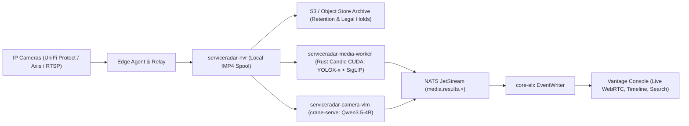

# ServiceRadar Vantage (VMS)

ServiceRadar Vantage is an edge-native IP camera Video Management System (VMS)
and visual intelligence engine built directly into ServiceRadar. Cameras are
managed as first-class inventory assets alongside routers, switches, and hosts,
inheriting the same network observability, unified credentials, SRQL
queryability, alerting, and Role-Based Access Control (RBAC).

- **Camera Fleet & Live Console**: `/cameras`
- **Unified Timeline, Clips & Holds**: `/cameras/:camera_source_id/recordings`
- **Recording & Storage Settings**: `/settings/recording`
- **Unified Credentials**: `/settings/networks/credentials`

## Overview

Vantage unifies physical security video with infrastructure operations so teams
do not run a separate appliance or cloud subscription for IP cameras:

- **Multi-vendor camera ingestion**: Supports **UniFi Protect** controllers,
  **Axis** cameras, and generic **RTSP / RTSPS** streams through edge agent
  plugins and stream relays. Camera credentials stay encrypted in
  `platform.network_credential_secrets` and are brokered to agents via
  credential rules rather than stored in plugin forms or Helm values. See
  [UniFi Protect](./unifi-protect.md) and [Credential Management](./credentials.md).
- **Unified inventory & network correlation**: Every camera source links to its
  underlying network device in ServiceRadar inventory, letting operators
  correlate PoE switch port health, link flaps, latency, and recording gaps in
  one place.
- **Zero-trust RBAC & auditability**: Live video (`devices.cameras.view`),
  historical playback (`devices.cameras.recordings.view`), and legal holds
  (`devices.cameras.recordings.hold`) are enforced separately per request, with
  every playback playlist access recorded in `RecordingAccessAudit`. See
  [Roles & Permissions](./rbac-and-roles.md).
- **Local GPU visual intelligence**: Object detection, visual embeddings, and
  Vision-Language Model (VLM) captioning run on in-cluster GPU workloads with
  zero external cloud video egress.

## Architecture and Data Flow

Vantage separates media capture, durable fMP4 storage, GPU visual indexing, and
operator playback into isolated planes so ML worker restarts or saturation never
disrupt continuous recording or live viewing.



| Stage | Component | Responsibility |
| --- | --- | --- |
| **Edge capture** | `serviceradar-agent` + camera plugins | Discovers cameras, negotiates RTSP/RTSPS media sessions using brokered credentials, and relays H.264/H.265 streams into the cluster over mTLS. |
| **Local spool & archive** | `serviceradar-nvr` StatefulSet | Seals fragmented MP4 (`init.mp4`, `media.m4s`, `descriptor.json`) blocks on replicated local storage, optionally uploads readback-verified copies to S3-compatible object storage, and enforces retention watermarks and legal holds (`RecordingHold`). See [Camera Recording & NVR](./camera-recording.md). |
| **Visual indexing (Stage 1)** | `serviceradar-media-worker` | Pure-Rust Candle CUDA worker that decodes sealed blocks via scoped Fragment Read Grants, runs **YOLOX-x** object detection (`Person`, `Vehicle`, `Animal`, `Package`) and **SigLIP** visual embedding extraction, and publishes structured frame results to NATS JetStream (`media.results.>`). |
| **Scene reasoning (Stage 2)** | `serviceradar-camera-vlm` | In-cluster Vision-Language Model service (`crane-serve` running **Qwen3.5-4B**) that generates natural-language scene captions, caption embeddings, and structured JSON answers for declarative Vantage ML pipelines. |
| **Ingestion & projection** | `core-elx` `EventWriter` | Consumes `media.results.>` from NATS JetStream and persists searchable visual frames, embeddings, and Vantage observations into CNPG. Media workers never hold database credentials. |
| **Operator UI** | `web-ng` Vantage Console | Serves live WebRTC/WebSocket playback, multi-block HLS v7 VOD playlists, hybrid semantic search, detection zone editing, and legal hold management. |

## Playback and Investigation Console

The Vantage console combines live situational awareness with frame-accurate
forensic playback on `/cameras/:camera_source_id/recordings`:

- **Unified Live WebRTC view**: Streams low-latency live video directly from
  the camera relay with automatic WebSocket fallback when a browser cannot reach
  the cluster peer directly. See [WebRTC TURN Relay](./webrtc-turn-relay.md).
- **Vertical Precision Timeline**: Newest-at-top coverage scrubber displaying
  local, archived, pending-archive, gap, and retention-deleted intervals across
  configurable spans (`15m`, `1h`, `6h`, `24h`, `7d`) with `+`/`-` zoom,
  timezone-aware timestamp jumps, and explicit `received` time-basis provenance.
- **Horizontal Thumbnail Filmstrip Scrubber**: Visual strip of sampled frame
  thumbnails synchronized with the playback head for rapid scrubbing across
  hours of footage without waiting for full segment buffering.
- **Tiered Smart / Motion Event Rail**: Coalesces detections into **Smart**
  (`Person`, `Vehicle`, `Animal`, `Package`) and **Basic** (`Motion`,
  `Recording`) clips with separate server-side budgets so high-volume motion
  never crowds out smart detections. Clicking any rail marker or clip card seeks
  directly to the peak frame.
- **Native Clip Modal with Frame-Accurate Overlays**: Opens focused clip windows
  backed by HLS v7 playlists carrying `#EXT-X-PROGRAM-DATE-TIME` tags. The
  player aligns each decoded video frame timestamp against indexed bounding
  boxes so `AI boxes` overlays track moving subjects frame-accurately during
  playback, pause, and stepping.

## Hybrid Semantic Action Search

Operators can search recorded footage across a camera or site using plain
natural-language descriptions (for example, `"white delivery van backing into
loading bay"` or `"person carrying a box near cam-north-gate-01"`).

Vantage executes a **Hybrid Semantic Search** that fuses three independent
retrieval signals using **Reciprocal Rank Fusion (RRF)**:

1. **Lexical full-text (`tsvector`)**: Matches exact object labels, scene
   caption keywords, and structured Vantage observation attributes.
2. **Caption semantic similarity (`caption_embedding`)**: Matches natural-language
   intent against embeddings generated from `serviceradar-camera-vlm`
   (`Qwen3.5-4B`) scene descriptions.
3. **Visual-text cross-modal similarity (`SigLIP`)**: Matches the text query
   vector directly against **SigLIP** visual frame embeddings produced by
   `serviceradar-media-worker`, surfacing scenes even when a specific detail was
   not spelled out in a caption.

All embedding, vision, and VLM inference runs locally on in-cluster GPU nodes.
No video frames, thumbnails, or search prompts are sent to external cloud APIs.

## Noise Reduction and Detection Zones

Fixed outdoor cameras frequently face busy roadways, swaying foliage, or parked
vehicles that generate alert fatigue if left unfiltered. Vantage provides two
controls to keep event rails and alerts focused on real activity:

- **12x8 Detection Zones ROI Grid (Non-PTZ Cameras)**: Operators draw **Focus**
  and **Ignore** cells directly on a camera snapshot using a `12x8`
  region-of-interest grid. Detections falling exclusively inside ignored cells
  (such as a public street or tree line) are masked before clip promotion and
  alerting, while focus cells prioritize entryways, gates, and loading docks.
- **Stationary-Vehicle Suppression**: Combines **motion-overlap** checks with
  **centroid-displacement gating** across consecutive frames. A parked vehicle
  whose bounding box remains stationary and lacks overlapping pixel motion is
  suppressed from generating repeated `Vehicle` events while still allowing a
  newly arriving or departing vehicle in the same frame to trigger normally.

## Vantage ML Extensibility and `serviceradar-sdk-vantage`

Beyond built-in detection and semantic search, Vantage supports custom vertical
video analytics (such as Automatic License Plate Recognition (ALPR), PPE
compliance, hazard monitoring, or bay approach guidance) packaged and
distributed as signed **Solution Packs** (`pack_format_version: 1`).

Custom pipelines declare selectors, Stage 1 triggers, ROI zones, and rate limits
in `vantage_pipelines/*.json` (`ServiceRadar.Camera.VantagePipeline`) and write
structured results exclusively through NATS JetStream
(`media.results.vantage.v1` -> Core `EventWriter`) into
`platform.camera_vantage_observations`. Observations are retention-coupled to
their source recording blocks, indexed for full-text and SRQL queries, and
rendered automatically on Vantage's timeline rail, clip overlays, and search.

### Three Progressive Compute Ramps

All three ramps produce the same canonical observation contract and ship inside
standard Solution Packs:

| Ramp | Execution Model | Best For |
| --- | --- | --- |
| **Ramp 1: Declarative VLM Prompt Pipelines** | Zero-code JSON pipeline definitions executed by `serviceradar-camera-vlm` (`Qwen3.5-4B` or configured OpenAI-compatible VLM) on **full-resolution cropped IDR keyframes** around Stage 1 detections (avoiding the readability ceiling of `480x270` full-scene thumbnails) with multi-frame track consensus. | Fast prototyping, OCR/ALPR, PPE checks, and scene classification with no custom container to build or host. |
| **Ramp 2: External Vantage Workers (`vantage.worker.v1`)** | Out-of-process Rust or Python workers built with **`serviceradar-sdk-vantage`** (Rust core crate wrapping `serviceradar-media-core` + Python PyO3 bindings + synthetic local dev harness). Workers pull jobs from JetStream, fetch sealed H.264 blocks via execution-time scoped **Fragment Read Grants** (`POST /v1/media/workers/read-grants`) with SHA-256 verification, and run with **zero database credentials**. | High-throughput or specialized models (Candle, ONNX, TensorRT, PyTorch) and third-party CV engines isolated across a process/network boundary. |
| **Ramp 3: WASM Action Bridges** | Connects Vantage observations and OCSF events to sandboxed `wazero` Wasm plugins (`serviceradar-sdk-go` / `serviceradar-sdk-rust`) for deterministic post-processing, external watchlist/API enrichment via brokered CNPG credentials, and northbound actions (such as gate or relay triggers). | Watchlist matching, ticket creation, webhook signing, and physical access/relay automation. |

The `vantage.worker.v1` frame envelope supports both `:recorded_block` (sealed
NVR blocks via Fragment Read Grants) and `:live_keyframe_tap` (bounded
camera-sharded live keyframe tap) so the same worker handler scales from
post-seal analytics to sub-second operational guidance without redesigning the
SDK or Solution Pack format.

### Querying Observations with SRQL (`in:camera_observations`)

Every Vantage pipeline observation is queryable in SRQL alongside network and
security telemetry:

```text
in:camera_observations pipeline:"alpr" camera:"cam-north-gate-01" time:last_24h
```

Synthetic example observation payload (stored in
`platform.camera_vantage_observations` for synthetic camera
`00000000-0000-0000-0000-000000000001` at `site-a` / `192.0.2.10`):

```json
{
  "camera_source_id": "00000000-0000-0000-0000-000000000001",
  "camera_name": "cam-north-gate-01",
  "site": "site-a",
  "pipeline_slug": "vantage-alpr",
  "signal_type": "license_plate_read",
  "observed_at": "2026-11-24T14:32:10Z",
  "confidence": 0.94,
  "attributes": {
    "plate_text": "ABC-1234",
    "vehicle_class": "van",
    "direction": "inbound"
  }
}
```

### Reference ALPR Solution Pack (`io.serviceradar.vantage-alpr`)

ServiceRadar ships a first-party Apache-2.0 reference pack,
`io.serviceradar.vantage-alpr`, demonstrating the full Vantage extensibility
stack:

- **Works out of the box on Ramp 1**: Triggers on Stage 1 `vehicle` detections,
  extracts full-resolution cropped IDR keyframes, and runs a structured JSON
  prompt against `serviceradar-camera-vlm` (`Qwen3.5-4B`) with multi-frame track
  consensus.
- **Upgrades seamlessly to Ramp 2**: When an operator deploys a compatible
  `vantage.alpr.v1` external worker (such as a permissive ONNX/Candle plate+OCR
  worker built with `serviceradar-sdk-vantage`), the pipeline dispatcher routes
  jobs to the worker automatically without changing dashboards, alerts, or SRQL
  queries.
- **Bundles everything in one signed `.srpack`**: Combines the
  `vantage_pipelines/` definition, `signal_schemas/`, OCSF alert rules, and an
  optional Dashboard SDK camera console module.

## Related Pages

- [Camera Recording & NVR](./camera-recording.md) -- NVR spool topology, S3
  archive bindings, retention watermarks, legal holds, and timeline HTTP API.
- [UniFi Protect](./unifi-protect.md) -- configuring UniFi OS credentials,
  rules, and camera stream plugins.
- [WebRTC TURN Relay](./webrtc-turn-relay.md) -- configuring TURN relay for
  low-latency live WebRTC playback across NAT boundaries.
- [Solution Packs & Declarative Checks](./solution-packs.md) -- `.srpack`
  packaging, ed25519 signing, and GitOps promotion.
- [SDKs & Plugin Development](./sdks.md) -- overview of `serviceradar-sdk-go`,
  `serviceradar-sdk-rust`, `serviceradar-sdk-dashboard`, Solution Packs, and
  `serviceradar-sdk-vantage`.
- [Credential Management](./credentials.md) -- unified CNPG credentials and
  brokered access rules.
