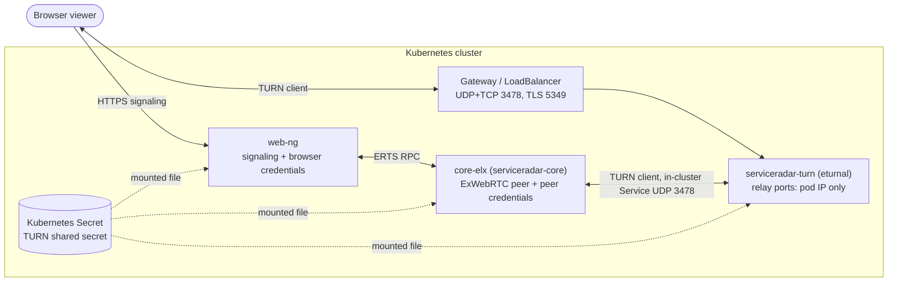

# WebRTC TURN Relay

Live camera viewing can play over WebRTC. The WebRTC peer that sends the video
is not in the browser's network: it is an ExWebRTC peer inside the `core-elx`
process, which runs in the `serviceradar-core` pods. A browser outside the
cluster cannot reach a pod address, and the pod usually cannot reach the
browser either, because both sides sit behind NAT, firewalls and the chart's
NetworkPolicies. Without a relay, no ICE candidate pair succeeds.

A failed WebRTC attempt is not fatal. The camera viewer waits for WebRTC media
for up to 8 seconds and then falls back to the websocket transports (WebCodecs
or MSE). The fallback works, but every view starts at least 8 seconds late.

A TURN relay removes that delay. Both peers allocate a relay address on one
TURN server, and media flows through it:



The working candidate pair is the browser's relay allocation paired with
core-elx's relay allocation, both on the same TURN pod. Host and
server-reflexive pairs are still tried first, so a viewer on a network that can
reach the peer directly does not use the relay.

## Which features use it

| Feature | Status |
| --- | --- |
| Camera relay live view (`webNg.cameraRelay.webRTC.enabled`) | Uses the shared ICE credential provider. Browser and core-elx each get their own minted TURN credentials. |
| Remote desktop (RDP) | Mints TURN credentials from its own Secret (`remoteAccess.desktop.rdp.webRTC.turn`). It can use the chart TURN server only if that Secret holds the same shared secret. See [Remote Access](./remote-access.md#rdp-webrtc-ice-and-turn). |

## Credential model

ServiceRadar uses the TURN REST shared-secret scheme (the scheme coturn calls
`use-auth-secret` and eturnal calls `secret`). One shared secret is known to
web-ng, core-elx and the TURN server. Nothing else, including the browser,
ever sees it.

For each WebRTC viewer, the shared ICE credential provider mints a short-lived
credential:

- `username = "<unix_expiry>:<subject>"`, where `<subject>` is a 32-character
  hex digest of the feature, relay session and viewer session. No user or
  session identifier appears in clear text.
- `credential = base64(HMAC-SHA1(shared_secret, username))`. The TURN server
  recomputes it and checks that the expiry has not passed.

web-ng mints the browser's credential (feature `camera_relay`) after core-elx
has assigned the viewer session, and returns it only in that viewer's signaling
response. core-elx mints its own credential (feature `camera_relay_peer`) for
its peer, against the in-cluster TURN Service. Minting is rate limited to 30
credentials per minute. A browser mint is keyed on the user and the relay
session. A core-elx peer mint is keyed on the actor `core-elx` and the viewer
session, so viewers of one camera do not share that bucket.

The shared secret is ServiceRadar-to-itself material: it authenticates
ServiceRadar to its own media relay. It therefore lives in an operator-owned
Kubernetes Secret (or one synced from OpenBao), mounted as a file. It is never
a Helm value, an environment value, or an entry in the unified credential
store. Create it once:

```bash
kubectl -n serviceradar create secret generic serviceradar-webrtc-turn \
  --from-literal=shared-secret="$(openssl rand -hex 32)"
```

The secret must be 32 to 512 printable, non-whitespace bytes. web-ng and
core-elx validate the mounted file at startup and refuse to start if it is
missing or malformed. The file is read again for every credential, so rotating
the Secret takes effect without a restart once the kubelet refreshes the
mount; restart the TURN pod after a rotation, because it reads the secret at
start.

## Helm values

| Value | Default | Meaning |
| --- | --- | --- |
| `webrtc.iceCredentials.backend` | `none` | `none` (STUN only) or `static_secret` (mint TURN credentials). |
| `webrtc.iceCredentials.ttlSeconds` | `600` | Credential lifetime, 60 to 3600 seconds. |
| `webrtc.iceCredentials.staticSecret.existingSecretName` | `""` | The Secret holding the shared secret. Required for `static_secret`. |
| `webrtc.iceCredentials.staticSecret.secretKey` | `shared-secret` | Key inside that Secret. |
| `webrtc.iceCredentials.turnUrls` | `[]` | Extra `turn:`/`turns:` URLs browsers dial (a TURN server you run outside this chart). URLs only, no credentials. |
| `webrtc.iceCredentials.peerTurnUrls` | `[]` | Extra `turn:` URLs core-elx dials. Must be reachable from the pod, with transport omitted or `transport=udp`. `turns:` and `transport=tcp` fail chart render. |
| `webrtc.turnServer.enabled` | `false` | Deploy the chart-managed TURN server (eturnal). Requires `backend: static_secret`. |
| `webrtc.turnServer.image.repository` / `.tag` | `ghcr.io/processone/eturnal` / `1.12.3` | TURN server image. |
| `webrtc.turnServer.externalHostname` | `""` | Required. The DNS name browsers dial. |
| `webrtc.turnServer.externalPorts.udp` / `.tcp` / `.tls` | `3478` / `3478` / `5349` | Ports browsers dial. Gateway listeners use them. With `exposure: service` they are the LoadBalancer Service ports. |
| `webrtc.turnServer.exposure` | `gateway` | `gateway` (Gateway API routes) or `service` (the TURN Service is a LoadBalancer). |
| `webrtc.turnServer.gateway.envoyGatewayNamespace` | `envoy-gateway-system` | Namespace of the gateway data-plane pods, admitted by the TURN NetworkPolicy. |
| `webrtc.turnServer.gateway.udp/tcp/tls.parentRefs` | `[]` | Listener references on a gateway this chart does not manage. Empty uses the chart-managed gateway. |
| `webrtc.turnServer.service.type` | `LoadBalancer` | Only `LoadBalancer` is accepted when `exposure: service`. Any other type fails rendering; use `exposure: gateway` instead. |
| `webrtc.turnServer.service.annotations`, `.loadBalancerIP`, `.externalTrafficPolicy` | `{}`, `""`, `Local` | Service tuning for `exposure: service`. |
| `webrtc.turnServer.service.allowedCIDRs` | `["0.0.0.0/0"]` | Client CIDRs admitted to the TURN ports when `exposure: service`. |
| `webrtc.turnServer.tls.enabled` | `false` | Serve TURNS on 5349 for networks that block UDP. |
| `webrtc.turnServer.tls.secretName` | `serviceradar-turn-tls` | TLS Secret for `externalHostname`. |
| `webrtc.turnServer.tls.certManager.issuerRef.kind` / `.name` | `ClusterIssuer` / `""` | When `name` is set, the chart creates a cert-manager Certificate. |
| `webrtc.turnServer.relayPortRange.min` / `.max` | `49160` / `49359` | Relay ports, at most 1000. Budget about four per concurrent viewer. |
| `webrtc.turnServer.deniedPeerCIDRs` | `[]` | Extra peer networks to refuse, on top of eturnal's `recommended` list. |
| `webrtc.turnServer.maxPermissions` | `10` | eturnal `max_permissions` per username. |
| `webrtc.turnServer.logLevel` | `info` | eturnal log level. |
| `webrtc.turnServer.resources` | 50m CPU / 64Mi request, 256Mi limit | Container resources. |
| `webrtc.networkPolicy` | disabled | Additive core-elx egress to an external TURN or STUN server. `remoteAccess.desktop.rdp.webRTC.networkPolicy` is an alias; set only one. |

The chart refuses to render when the backend is unknown, the TTL is out of
range, `static_secret` has no Secret, no browser TURN URL or no core-elx TURN
URL, a TURN URL carries credentials, or the TURN server is enabled without an
external hostname or without `static_secret`.

The values reach the releases as environment variables:
`SERVICERADAR_WEBRTC_ICE_BACKEND`, `SERVICERADAR_WEBRTC_ICE_CREDENTIAL_TTL_SECONDS`,
`SERVICERADAR_WEBRTC_TURN_SHARED_SECRET_FILE`
(`/etc/serviceradar/webrtc-turn/shared-secret`) and
`SERVICERADAR_WEBRTC_TURN_URLS_JSON`. web-ng gets the external URLs; core-elx
gets `turn:serviceradar-turn.<namespace>.svc.cluster.local:3478?transport=udp`.

### Example: chart-managed gateway

```yaml
gatewayApi:
  enabled: true
  mode: managed
  host: serviceradar.example.com

webNg:
  cameraRelay:
    webRTC:
      enabled: true
      iceServers:
        - urls:
            - "stun:stun.example.com:3478"

webrtc:
  iceCredentials:
    backend: static_secret
    staticSecret:
      existingSecretName: serviceradar-webrtc-turn
  turnServer:
    enabled: true
    externalHostname: turn.example.com
    tls:
      enabled: true
      certManager:
        issuerRef:
          name: example-issuer
```

The managed gateway gains `turn-udp` (UDP 3478), `turn-tcp` (TCP 3478) and
`turn-tls` (TLS 5349, passthrough) listeners.

### Example: a shared gateway the chart does not manage

The routes attach to listeners you define on the shared Gateway:

```yaml
webrtc:
  turnServer:
    enabled: true
    externalHostname: turn.example.com
    tls:
      enabled: true
    gateway:
      udp:
        parentRefs:
          - {name: shared-gateway, namespace: gateway-system, sectionName: turn-udp}
      tcp:
        parentRefs:
          - {name: shared-gateway, namespace: gateway-system, sectionName: turn-tcp}
      tls:
        parentRefs:
          - {name: shared-gateway, namespace: gateway-system, sectionName: turn-tls}
```

On that Gateway, add listeners like these and let them admit routes from the
ServiceRadar release namespace:

```yaml
listeners:
  - name: turn-udp
    port: 3478
    protocol: UDP
    allowedRoutes:
      namespaces: {from: All}
  - name: turn-tcp
    port: 3478
    protocol: TCP
    allowedRoutes:
      namespaces: {from: All}
  - name: turn-tls
    hostname: turn.example.com
    port: 5349
    protocol: TLS
    tls:
      mode: Passthrough
    allowedRoutes:
      namespaces: {from: All}
```

Prefer a namespace selector over `from: All` where your gateway policy allows
it.

## Exposing the TURN server

- **Ports.** Open UDP 3478, TCP 3478 and, with TLS, TCP 5349 at the edge
  (cloud firewall, security group, or on-premises firewall in front of the
  gateway or load balancer). Nothing else. The relay port range is never
  exposed: relay addresses are the TURN pod's own address, and the far end of
  every relayed connection is core-elx inside the cluster.
- **DNS.** Point `externalHostname` (for example `turn.example.com`) at the
  gateway or load balancer address that carries the TURN listeners. The chart
  does not publish this record.
- **Certificate.** eturnal terminates TLS itself; the gateway passes TLS
  through. The certificate must cover `externalHostname`. Use cert-manager
  (`tls.certManager.issuerRef.name`) or create the `kubernetes.io/tls` Secret
  named by `tls.secretName`.
- **TLS on 443.** Some networks allow only TCP 443. A TURNS listener on 443 is
  possible only as a TLS passthrough listener whose hostname does not collide
  with an HTTPS listener on the same port, and only if your gateway supports
  mixing them. If you do this, set `externalPorts.tls: 443` so browsers are
  given the right URL, and test it before relying on it.
- **Load balancers.** With `exposure: service`, the Service carries UDP and TCP
  on the same port. Mixed-protocol LoadBalancer Services need Kubernetes 1.26
  or later and a load-balancer implementation that supports them. Keep
  `externalTrafficPolicy: Local` so `service.allowedCIDRs` sees real client
  addresses.
- **One replica.** The TURN Deployment runs one replica on purpose. The
  browser's allocation and core-elx's allocation must be on the same pod,
  because the pod refuses to relay to any other private address.

## Network policy

When `networkPolicy.enabled` is true, the chart adds:

- `serviceradar-turn-ingress`: client ports from the gateway namespace (or
  from `service.allowedCIDRs`), UDP 3478 and the relay range from
  `serviceradar-core` pods, and the relay range from the TURN pod itself.
- `serviceradar-turn-core-egress`: core-elx to the TURN pod on the in-cluster
  Service UDP port (3478 with gateway exposure, `externalPorts.udp` with
  service exposure) and the relay range.
- `serviceradar-turn-relay-egress`: the TURN pod to itself on the relay range,
  so relay-to-relay media still flows when same-namespace egress is off.
- With `networkPolicy.calicoLogDenied.enabled`, Calico `Allow` rules for that
  core-elx egress and for the TURN pod's relay egress, ordered just before the
  final log-and-deny policy.

The TURN server also refuses to relay to eturnal's `recommended` networks
(RFC 1918, loopback, link-local, CGNAT, ULA and similar) and to
`deniedPeerCIDRs`. The one private address it allows is its own relay address.
Add your pod and service CIDRs to `deniedPeerCIDRs` if they fall outside the
recommended list.

## Verifying

1. Confirm the signaling response carries minted credentials. In the browser
   developer tools, the response to
   `POST /api/camera-relay-sessions/<id>/webrtc/session` has
   `"ice_credentials": "minted"` and an `ice_servers` entry with `turn:` URLs,
   a `username` and a `credential`.
2. Open a camera from a network outside the cluster, ideally one that blocks
   direct UDP to the cluster (a phone hotspot or a guest network works).
3. Open `chrome://webrtc-internals` (Chrome) or `about:webrtc` (Firefox). The
   selected candidate pair for the camera connection should have a local
   candidate of type `relay`, and the connection state should reach
   `connected` well inside 8 seconds.
4. Check the TURN server sees the allocations:

   ```bash
   kubectl -n serviceradar logs deploy/serviceradar-turn
   ```

   Each viewer should open TURN sessions from two client addresses: the
   gateway's (browser side) and a core-elx pod's (peer side). Raise
   `webrtc.turnServer.logLevel` to `debug` if the default level is too quiet.
5. The viewer should show WebRTC playback, not the websocket fallback.

There is no setting yet to force relay-only ICE in the browser, so step 2
relies on the network to rule out direct pairs.

## Troubleshooting

| Symptom | Likely cause and fix |
| --- | --- |
| `ice_credentials` is `not_configured` | `webrtc.iceCredentials.backend` is `none`. |
| `ice_credentials` is `unavailable`, and web-ng or core-elx logs `WebRTC ICE credential mint failed: backend=... feature=... reason=...` | The provider could not mint (for example the secret file vanished). The viewer gets STUN only and falls back to the websocket. The log names the backend and reason and never includes the shared secret. |
| `ice_credentials` is `rate_limited`, and the same warning names `reason=:rate_limited` | More than 30 browser mints per minute for one user and relay session, usually a reconnect loop. core-elx peer mints are limited per viewer session, so viewers of one camera do not share that bucket. |
| web-ng or core-elx will not start, naming the WebRTC configuration | The secret file is missing or not 32 to 512 printable bytes, a TURN URL is malformed, or the TTL is out of range. |
| eturnal logs authentication failures (401) | The TURN server and ServiceRadar disagree on the secret: they mount different Secrets, or the Secret was rotated and the TURN pod was not restarted. |
| Authentication fails only after some minutes, or intermittently | Clock skew. The username carries an expiry checked against the TURN server's clock. Keep node clocks NTP-synced. |
| No relay candidates at all in `webrtc-internals` | The browser cannot reach `externalHostname` on 3478: DNS, the edge firewall, or the gateway listener. Test with TLS 5349 if UDP is blocked. |
| TURNS fails with a certificate error | The certificate does not cover `externalHostname`, or the gateway terminates TLS instead of passing it through. |
| Relay candidates exist but the pair never connects | A NetworkPolicy or Calico policy blocks core-elx to the TURN pod, or the relay ports. Check `networkPolicy` and the policies listed above. |
| Works for a few viewers, then new viewers fall back | The relay port range is exhausted. Widen `relayPortRange` (about four ports per concurrent viewer). |
| Viewers still fall back after 8 seconds | Work through the rows above in order, starting with the signaling response. |
